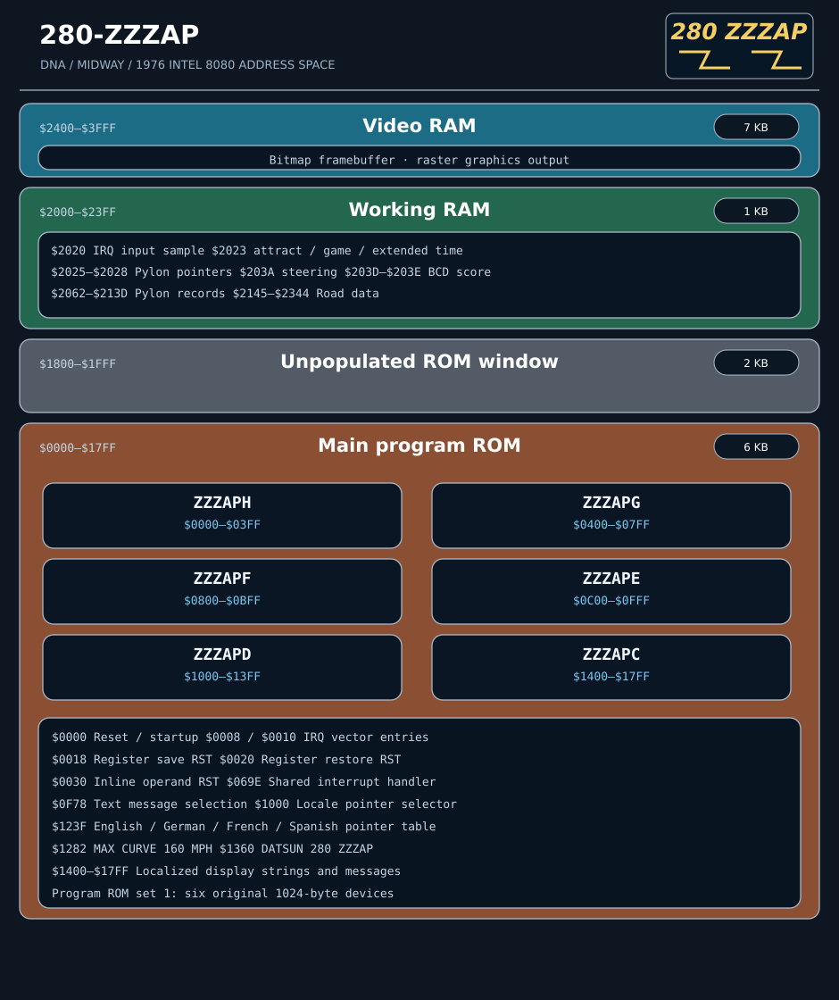

# 280-ZZZAP (1976)

**280-ZZZAP** is a 1976 driving arcade game developed by **Dave Nutting Associates (DNA)** and published by **Midway**. It runs on the Midway Intel 8080 arcade platform.


This project reconstructs the original 8080 program into readable, maintainable, annotated assembly. The original ROM bytes remain the authority. The reverse-engineering work identifies native routines, interrupt services, RAM structures, display assets, road/pylon logic, sound output, and multilingual game text.

| Topic | Description |
| --- | --- |
| Native architecture | Reset and frame interrupt vectors, register-preserving RST helpers, native game routines |
| Game engine | Steering, road/pylon data, timing, collisions, score and high-score |
| Graphics and text | Bitmap graphics and localized text in English, German, French and Spanish |
| Hardware | 8080 inputs/outputs, working RAM, framebuffer and sound-board netlist |
| Rebuild | Original zmac v1.3 toolchain, six independent 1 KB ROM verification checks |

## Repository

- `src/280zzzap.asm` — full 6 KB Intel 8080 ROM source pass: native instructions, graphics, data and text
- `src/nl_280zzzap.cpp`, `src/nl_280zzzap.h` — netlist hardware sources
- `tools/zmac`, `tools/zmac.exe` — project assemblers for Linux and Windows
- `build.sh`, `build.bat` — native assembly build and ROM verification
- `roms/original/280zzzap.zip` — preserved MAME parent set
- `roms/original/280zzzapa.zip` — preserved alternate ROM set
- `docs/06-280-ZZZAP-NATIVE-ENGINE-AND-LINEAGE.md` — native architecture and lineage audit
- `images/280zzzap-memory-map.svg` — populated ROM devices and hardware memory regions

## Build

Linux:

```sh
./build.sh
```

Windows:

```bat
build.bat
```

The scripts use the included **zmac v1.3**, preserve source and original archives, emit a contiguous 6144-byte program image, split the image into six 1024-byte devices, and verify their SHA-1 hashes before creating `roms/280zzzap.zip`. **No Python is used.** The source now covers the complete 6 KB parent ROM image. It includes native instruction decoding and structured ROM data. **Build verified November 20, 2026:** the assembly completed successfully, all six original ROM device SHA-1 hashes matched, and the generated ROM set ran in MAME (user-confirmed). Detailed results: [RE coverage and verification](docs/280zzzap-re-coverage.md).

MAME:

```sh
mame 280zzzap -rompath roms -window -skip_gameinfo
```

## Original ROMs: MAME set 1

| Device | CPU addresses | Size | SHA-1 |
| --- | --- | ---: | --- |
| `zzzaph` | `$0000–$03FF` | 1024 | `b9cf16eb037ada73631ed24297e9e3b3bf6ab3cd` |
| `zzzapg` | `$0400–$07FF` | 1024 | `b2e2497e421e79a411d07ebf2eed2bb8dc227003` |
| `zzzapf` | `$0800–$0BFF` | 1024 | `206bf2575696c4b14437f3db37a215ba33211943` |
| `zzzape` | `$0C00–$0FFF` | 1024 | `ae5cf4481ee4b78ca0d2f4d560d295e922aa04a7` |
| `zzzapd` | `$1000–$13FF` | 1024 | `972475f80253bb0d24773a10aec26a12f28e7c23` |
| `zzzapc` | `$1400–$17FF` | 1024 | `ffa6bb84ef1f7c2d72fd26c24bd33aa014aeab7e` |

The alternate MAME set `280zzzapa` has three 2 KB devices (`h`, `g`, `f`); it is a distinct program revision, not a byte-identical ROM repackaging. MAME designates set 1 as the parent.

## Memory organization

| Address range | Use |
| --- | --- |
| `$0000–$17FF` | Six populated 1 KB program ROM devices |
| `$1800–$1FFF` | Unpopulated part of the hardware ROM window |
| `$2000–$23FF` | 1 KB working RAM: driving state, timers, score, pylon and road tables |
| `$2400–$3FFF` | 7 KB raster video RAM |



The 8080's I/O instructions address control and sound ports separately from memory. In particular: `IN $00` reads start/coin/gear/pedal, `IN $01` reads steering, and `IN $02` reads DIP switches. Do not treat the text-localization table as a programming-language interpreter.

## Native architecture

The ROM starts at `$0000`; interrupt entries at `$0008` and `$0010` feed the shared handler at `$069E`. The `RST $18` / `RST $20` pair saves and restores registers. `RST $30` consumes an inline byte and advances the caller's return address. Native control flow processes hardware input and manipulates RAM-backed road, pylon, and game state.

**Execution model: native 8080 assembly.** The CPU directly executes instructions in the six program ROMs. Reset initializes the game; interrupt entries at `$0008` and `$0010` enter a common native handler at `$069E`. Native routines handle steering, timing, road/pylon generation, graphics, scoring and output. The compact `RST` services save/restore registers or consume an inline argument; they are CPU instructions, not a TERSE-style interpreter.

**The selector is for on-screen text localization.** `SELECT_LOCALE_POINTER` at `$1000` reads DIP-switch bits from input port `$02`, selects one of the four pointer entries at `$123F`, and returns the message-table pointer for English, German, French, or Spanish. `DISPLAY_TEXT_BY_LOCALE` handles display of the selected text. This is a data-table lookup, not opcode dispatch or a programming-language selector.

The original ROM set is **6,144 bytes of program and data**, so the complete assembly is compact despite covering all six ROM devices. It is approximately **3,600 source lines**, including 8080 instructions, display fonts, bitmap graphics, drawing descriptors, packed road geometry, steering lookup tables, and encoded multilingual text. The separate `src/nl_280zzzap.cpp` is a hardware/audio netlist, not additional game program code. See [native engine and lineage](docs/06-280-ZZZAP-NATIVE-ENGINE-AND-LINEAGE.md) and [RE coverage](docs/280zzzap-re-coverage.md).

## Reverse-engineering requirements

The reconstruction should follow clean source formatting: explanatory section headers, whitespace between native routines, descriptive labels, named RAM definitions, and inline glyph/graphic renderings. Represent actual text as text and address tables as words; analyze compressed data and graphics by their real structure. Byte-exact matching of all six original ROM devices is the release criterion.

## Documentation

- [Native engine and lineage](docs/06-280-ZZZAP-NATIVE-ENGINE-AND-LINEAGE.md)
- [280-ZZZAP game logic schematic](docs/280_ZZZap_Game_Logic_(0610-00907A).pdf)
- [280-ZZZAP wiring diagram, December 1, 1976](docs/280_ZZZap_Wiring_Diagram_(12_1_1976).pdf)
- [German-language 280-ZZZAP documentation](docs/280-Zzzap-deutsch-german.pdf)
- [MAME Midway 8080 driver](https://github.com/mamedev/mame/blob/master/src/mame/midw8080/mw8080bw.cpp)
