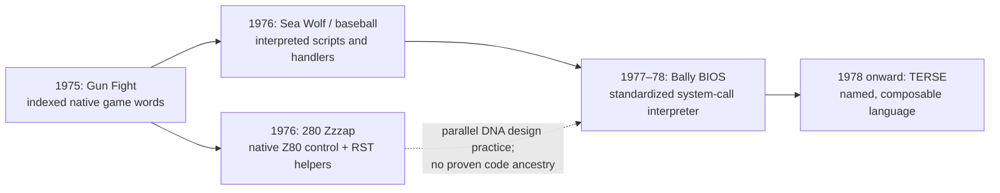
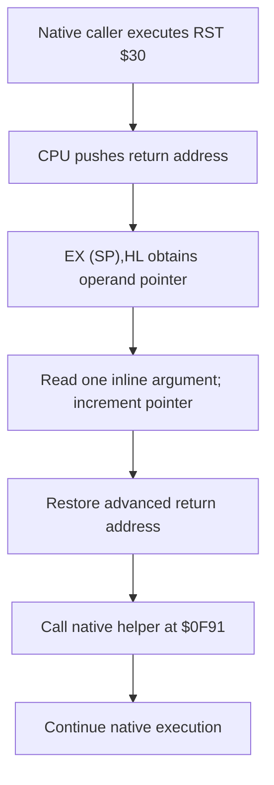
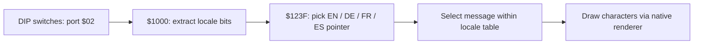
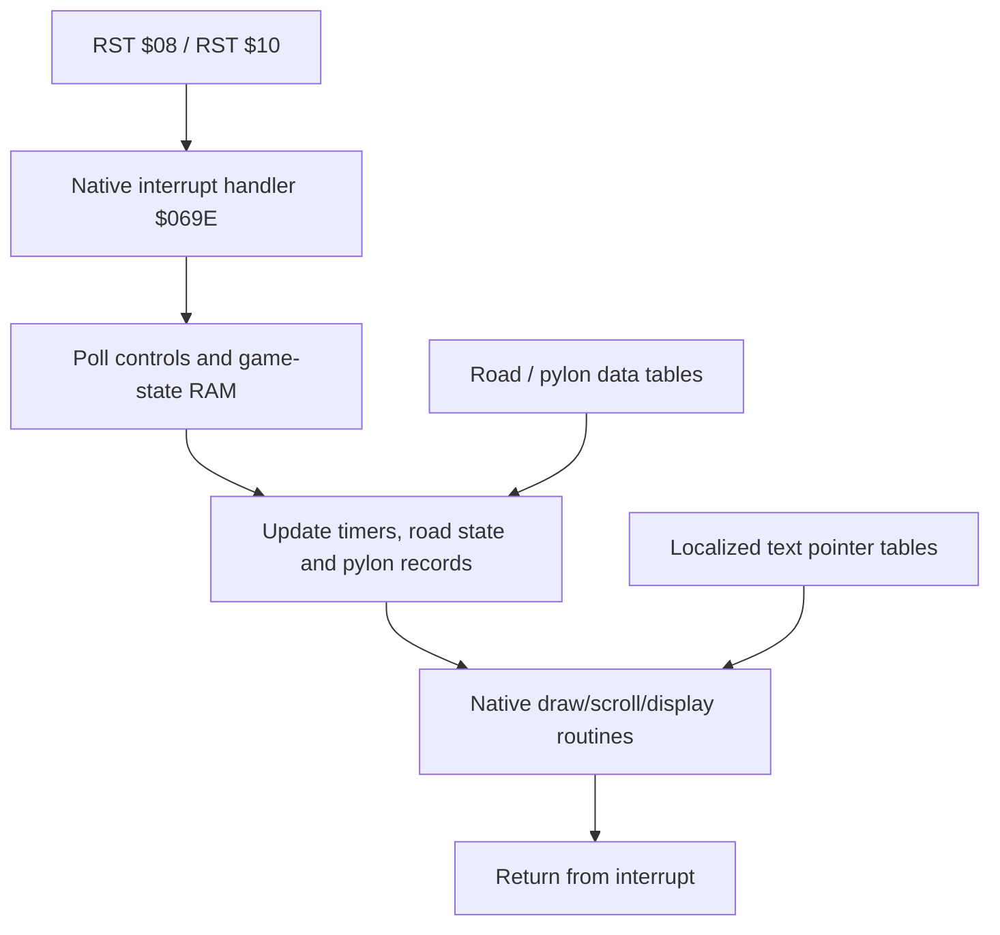

# 280 Zzzap: Native Game Architecture Beside DNA's Interpreters

**DNA interpreter evolution research · 2026-10-30 · v20261030-0001**

**Primary source:** Mark Spaeth, [`mcspaeth/280zzzap_z80`](https://github.com/mcspaeth/280zzzap_z80), especially [`zzzap_dz80.asm`](https://github.com/mcspaeth/280zzzap_z80/blob/master/zzzap_dz80.asm) (addressed hexadecimal listing), [`zzzap.asm`](https://github.com/mcspaeth/280zzzap_z80/blob/master/zzzap.asm) (annotated reconstruction), and the accompanying font, text, and graphics sources. These are third-party reconstructions, not a statement of original DNA source-code provenance. The `.obj` and `.lst` are also in the upstream repository. The analysis below is based on inspection of these source texts; **no original-ROM-byte identity check or runtime trace was performed in this pass**.

## Executive finding

280 Zzzap is useful to the history, but **not because it supplies another confirmed indexed bytecode interpreter**. Its source shows a substantial native Z80 arcade game, with hardware-facing interrupt routines, reusable restart-vector helpers, compact inline parameters, structured RAM object state, screen drawing, and internationalized text. I did **not** identify a Sea Wolf-style persistent game-script PC, contiguous bytecode stream, or one-byte-to-native-handler interpreter table in the reviewed code.

That is positive historical evidence of **parallel engineering choices**: DNA could build complete games around native code and reusable native services while other games used interpreted command streams. A special-purpose service accessed through `RST` is not automatically a high-level language interpreter.

### Where this fits



The dashed connection is **architectural context**, not an assertion that 280 Zzzap's routines became Bally BIOS code.

## 1. Actual restart-vector helpers, not a game-word dispatch table

The raw address listing exposes specialized small Z80 routines at fixed restart vectors. For example, `RST $18` preserves context and returns to the point after the restart instruction:

```asm
; zzzap_dz80.asm: $0018–$001C (comments paraphrased)
0018: E3        ex   (sp),hl
0019: D5        push de
001A: C5        push bc
001B: F5        push af
001C: E9        jp   (hl)
```

The companion `RST $20` helper restores context:

```asm
0020: E1        pop  hl
0021: F1        pop  af
0022: C1        pop  bc
0023: D1        pop  de
0024: E1        pop  hl
0025: C9        ret
```

These create a reusable Z80 service convention. They are **not** by themselves evidence of a fetched bytecode command or user-defined word dictionary.

`RST $30` is more revealing: it reads an **inline byte after its calling instruction** by temporarily exchanging `HL` with the return address on the CPU stack.

```asm
; zzzap_dz80.asm: $0030–$0037
0030: E3        ex   (sp),hl
0031: 7E        ld   a,(hl)      ; inline operand from caller
0032: 23        inc  hl
0033: E3        ex   (sp),hl      ; advance return address
0034: CD 91 0F  call $0F91
0037: 77        ld   (hl),a
```

This shows **inline-operand service calls**, conceptually relevant to both the Bally BIOS interface and the earlier arcade language words. But the CPU return address is used directly; the excerpt does not expose a separately maintained script PC or a handler indexed by a game opcode.



**Caution:** `RST $18`, `$20`, `$30` and the BIOS's `RST $38` are not interchangeable: the mechanism and service conventions need independent byte-level comparison before claiming direct reuse.

## 2. A different kind of table lookup: internationalized message strings

The reconstruction contains many references to a **“language table”**. Here, *language* means screen-text localization, not a programming language or game-command vocabulary.

At `$1000`, DIP-switch input selects one of four language-table pointers:

```asm
; zzzap_dz80.asm: $1000–$100E
1000: DB 02     in   a,($02)
1002: 07        rlca
1003: 07        rlca
1004: 07        rlca
1005: E6 06     and  $06
1007: 5F        ld   e,a
1008: 16 00     ld   d,$00
100A: 19        add  hl,de
100B: 5E        ld   e,(hl)
100C: 23        inc  hl
100D: 56        ld   d,(hl)
100E: C9        ret
```

The pointer table at `$123F` is explicitly labeled English, German, French, Spanish in the disassembly:

```asm
123F: 4D 12     ; English table pointer adjustment
1241: F0 13     ; German
1243: 51 15     ; French
1245: B3 16     ; Spanish
```

In the string renderer, `$0F78` loads that table, calls `$1000`, and looks up the selected phrase pointer. The screen-text phrases include “SCORE”, “INSERT COIN”, “GAME OVER”, and similar messages.



The fact that `$1000` doubles an index and retrieves a two-byte pointer is **not evidence of a game interpreter**. It is a normal indexed-data lookup; the selected target is a string table, not an executable service routine.

## 3. Native scheduling and object-based road generation

The two interrupt vectors feed a shared native handler at `$069E` with different `C` values:

```asm
; zzzap_dz80.asm: reset-vector area
0008: F5        push af
0009: C5        push bc
000A: D5        push de
000B: 0E 00     ld   c,$00
000D: C3 9E 06  jp   $069E

0010: F5        push af
0011: C5        push bc
0012: D5        push de
0013: 0E 01     ld   c,$01
0015: C3 9E 06  jp   $069E
```

At `$069E`, the interrupt handler polls input port `$00`, detects coin transitions, updates working RAM, and selects work according to the interrupt phase. This is native frame/event orchestration rather than an observed interpreted-script handoff.

The RAM annotations in `zzzap.asm` identify structures consistent with a road-and-pylon engine:

| Address | Annotated use |
|---|---|
| `$2023` | Attract / gameplay / extended-time state |
| `$2025–$2028` | Pointers to pylon tables |
| `$203A` | Steering value |
| `$203D–$203E` | Score in BCD |
| `$204B–$2053` | Timed animation records / linked substructure |
| `$2062–$20CF` | One 22-entry × 5-byte pylon table |
| `$20D0–$213D` | Second 22-entry × 5-byte pylon table |
| `$2145–$2244` | One road-data table |
| `$2245–$2344` | Companion road-data table |
| `$2400–$3FFF` | Bitmap display memory (as annotated upstream) |

These descriptions come from the upstream comments; question-marked fields in the original source should remain provisional.



This does not exclude short interpretive sequences elsewhere; it describes what is demonstrable from the inspected major execution paths and tables.

## 4. Comparison with the early DNA interpreters

| Question | Sea Wolf (1976) | 280 Zzzap (reviewed source) | Bally BIOS (1977–78) |
|---|---|---|---|
| Independent interpreted program pointer | RAM `$2000–$2001` | **Not identified** | Interpreter context / call-stream state |
| One-byte indexed native game-word table | At `$09E8` | **Not identified** | Numbered UPI system services |
| Program zero/command handoff to native frame services | Yes | No matching opcode-zero mechanism identified | Not the same game-script model |
| Native hardware and frame services | Yes | Yes | Yes, shared BIOS services |
| Inline parameters | In game-command packets | Via `RST $30` and other native helpers | Yes, through UPI service calling conventions |
| Native use of indexed tables | Yes | Yes, notably localization and road tables | Yes |
| Meaning for lineage | Demonstrated indexed interpreter | Parallel native-first design | Standardized interpreter/service interface |

### Why the negative finding matters

A simple chronology such as “every DNA game used the same interpreter and it gradually became TERSE” would be false or at least unsupported. The 280 Zzzap source makes the more credible story possible: **the studio used different architectures suited to their games, sharing techniques such as ROM tables, register-context tricks, compact calls, and high-speed native display routines.** The evidence for genuine command-stream interpreters should remain attached to the titles that actually contain them.

## 5. Recommended placement in ODT v3

Include a concise sidebar or comparative section near the 1976–78 transition, titled **“280 Zzzap: a native-code counterpart.”** Its narrative role is similar to Checkmate: a purposeful contrast to Sea Wolf and the baseball interpreter family, not a forced link in a single bytecode lineage.

Use two illustrated examples: (a) `RST $30` consuming an inline byte and resuming native code; (b) the `$1000` locale-table lookup as a reminder that **not every indexed table is a programming-language dictionary**.

Suggested takeaway: *While DNA's indexed-command game programs became more expressive, other titles used tight native Z80 logic with reusable register-preserving restart services and structured data. Both approaches contributed engineering techniques to the environment in which the Bally BIOS and TERSE emerged.* The last sentence is an architectural interpretation, **not a demonstrated shared-code ancestry claim**.

## 6. Next verification targets (not prerequisites to using this finding)

1. Compare the actual 280 Zzzap original ROM bytes against Spaeth's disassembly and identify any patches or alterations, as was done for Sea Wolf.
2. Trace representative callers of `RST $18`, `$20` and `$30`, including the stack state through `RST $30` and `$0F91`.
3. Inspect remaining tables for executable vectors versus data pointers before concluding that there are *no* hidden bytecode-like mechanisms.
4. Compare distinctive native service sequences with Bally BIOS and with Sea Wolf; similarity in `RLCA` plus a pointer table alone is not evidence of code reuse.

## Source references

- [Mark Spaeth: mcspaeth/280zzzap_z80](https://github.com/mcspaeth/280zzzap_z80)
- [`zzzap.asm`](https://github.com/mcspaeth/280zzzap_z80/blob/master/zzzap.asm) — annotated assembly and RAM map
- [`zzzap_dz80.asm`](https://github.com/mcspaeth/280zzzap_z80/blob/master/zzzap_dz80.asm) — instruction addresses and bytes used in the excerpts above
- Our previous research: `05-SEA-WOLF-ARCADE-INTERPRETER-AND-LINEAGE.md` and `01–04` in the same research set

**Evidence status:** This is an initial static-source examination, not an exhaustive control-flow proof. It does not establish direct code inheritance from or to Bally BIOS/TERSE.
